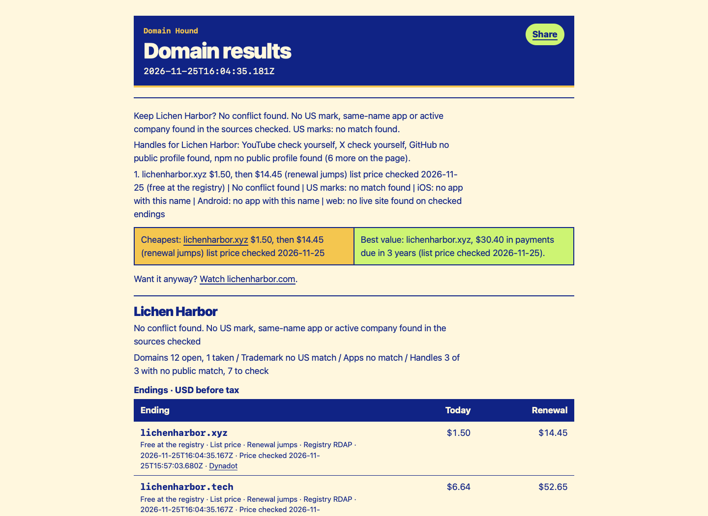

# Domain Hound: Domains for agents

One MCP for everything domains: find, check, buy, set up, watch, move, renew, keep track.

Domain Hound finds names and checks domain availability, first-year and renewal prices, app names, trademarks and social handles from Claude Code, Codex or any MCP client. Connect your Spaceship account to quote a domain, buy it with your approval and set up DNS. It also investigates and watches taken domains, plans moves to a cheaper registrar, and keeps track of every domain you own. It runs locally.

- **Find and check:** `triage_names`, `check_domains`, `naming_method`
- **Buy and set up:** `quote_domain`, `buy_domain`, `setup_domain`
- **Watch taken domains:** `taken_domain_dossier`, `watch_domain`
- **Plan a move:** `move_domain`
- **Track domains and renewals:** `my_domains`



## Install

Requires Node.js 20 or later.

**Claude Code**

```sh
claude mcp add domain-hound -- npx -y domain-hound
```

**Codex**

```sh
codex mcp add domain-hound -- npx -y domain-hound
```

**Other MCP clients**

Add this to the client’s MCP configuration for a local stdio server.

```json
{
  "mcpServers": {
    "domain-hound": {
      "command": "npx",
      "args": ["-y", "domain-hound"]
    }
  }
}
```

Then ask, for example: “Is lanternbay.com available?”, “Find a name for my meeting-room booking app”, “Is the app name Quiet Otter taken?”, “Buy lanternbay.com and point it at my Vercel site” or “Which of my domains expire soon?”

## Find and check

### What it checks

- **Domains:** registry RDAP or WHOIS for twelve endings by default (.com, .ai, .io, .me, .co, .dev, .app, .si, .so, .no, .xyz, .tech) and, on request, .net, .org, .sh, .gg, .inc, .studio, .se, .dk, .de, .uk, .co.uk and .eu. A domain is never called free without a registry or shop answer.
- **Pick:** one quality order for AI-native companies: .com, .ai, .io, .dev, .app, .co, .so, .me, .si, then .xyz and .tech; other endings follow. The pick is the highest-quality free ending you can register whose payments over 3 years stay within $60, or within your budget when you give one; if none fits, it is the one with the least paid over 3 years. .ai is never the default pick unless you ask for it or its 3-year total fits your budget. Endings you list come first, in your order. A budget also drops endings that cost more than it upfront. The cheapest upfront payment and the best 3-year value get their own lines when they differ from the pick. Every checked ending stays on the page.
- **Prices:** first payment, renewal and three-year cost from first-party registrar price lists, each with its date and label; renewal jumps and premium risk are flagged. Cloudflare's standard at-cost prices come from its official public table ([pricing.registrar.cloudflare.com](https://pricing.registrar.cloudflare.com/)), checked 2026-11-25 and shipped as a dated estimate; they compete with the other registrars, and rows priced there say Needs Cloudflare DNS.
- **Trademarks:** live US marks (USPTO). EU (EUIPO) and Norwegian (Patentstyret) marks too when you set their free keys; otherwise, and for WIPO, search links to check yourself. Exact and near-identical live marks in the relevant classes (9, 35 and 42 for software) count the same at every office.
- **Meaning:** names that are, contain or sound like a rude word in 14 languages get a note and Check first, never Avoid. Word lists: [LDNOOBW](https://github.com/LDNOOBW/List-of-Dirty-Naughty-Obscene-and-Otherwise-Bad-Words), © Shutterstock, CC BY 4.0, adapted (see `clis/domain-check/meaning-words.LICENSE.txt`).
- **Apps and rivals:** same-name iOS and Android apps, companies, Wikidata entities and live sites, weighed by their traction.
- **Handles:** GitHub, npm and Bluesky through their public APIs; YouTube, X, Instagram, TikTok, Facebook, LinkedIn and PyPI as links to check yourself. Each handle reads Taken, No public profile found, or Check yourself.

Registry answers and prices cover every name. Trademark, app and rival checks cover the first five. Slow checks and public handles for the top three fill in the same results page after the first answer. A three-year savings line appears when the pick beats the middle price from at least three dated registrar lists.

The default install checks the registry and shows dated list prices. For a confirmed price, set `DOMAIN_HOUND_SPACESHIP_KEY` and `DOMAIN_HOUND_SPACESHIP_SECRET` (Spaceship permission `domains:read`), or `DOMAIN_HOUND_DYNADOT_KEY` (a production API key). Dynadot gives its production key account-wide access. Domain Hound only uses it to search. It shows premium pricing when it has a quote and points you to the shop when it has a premium signal without a price.

GitHub allows 60 anonymous API requests an hour. To check GitHub handles more often, set `DOMAIN_HOUND_GITHUB_TOKEN` to a token with no scopes; Domain Hound sends it only to `api.github.com`.

For the optional browser fallback, run `npm install domain-hound playwright && npx playwright install chromium` in a project directory and start your MCP client there. Ask for a live shop check to set the `confirm` tool flag, or use `--confirm` with the CLI.

### Guides

- [Check domain availability](https://domainhound.dev/guides/how-to-check-domain-availability/)
- [Find an available startup name](https://domainhound.dev/guides/find-an-available-startup-name/)
- [Check whether an app name is taken](https://domainhound.dev/guides/is-my-app-name-available/)

Use `check_domains` for one exact domain or up to 20 names or domains. Use `triage_names` to screen a short list or a name you already have. Ask for `naming_method` to see how a shortlist is generated.

### Naming skill and Name score

Brainstorm names all day. If they're not available, it's pointless. The naming skill gives your agent one method: subject words, six territories, five recipes (odd pair, pun, blend, insider term, phrase or character), hard bans, and one steering question: "Which two do you love, and which one do you hate?" The Claude Code plugin ships it as `skills/naming/SKILL.md`; any MCP client gets the same method from `naming_method`.

`triage_names` gives each of the first five names a **Name score**, 0 to 100: how clear the road is. It is not a probability. Points come from the best free ending (22), its 3-year price (3), trademarks (25), rivals (20), apps (8), handles (7) and name quality (15). Bans (digits, hyphens, -ly, -ify, -io, AI, GPT, bot, smart, generic words like hub or labs, over 12 letters) and hard filters (no free ending within $60 over 3 years, an identical live trademark in your classes, a strong same-name rival in your subject, a severe bad meaning) run first, in code; those names get no score and are never a pick. A check that failed counts 40% of its points and says "Not checked". Trademarks stay at 20 of 25 until the EU office answers. A failed US trademark or rival check keeps the total at 79 or less, and so does missing `candidates` evidence for the bans code cannot judge on its own. Bands: 80+ Strong, 60 to 79 Workable, 40 to 59 Risky, under 40 Advise against. Picks rank by score. Each scored name shows up to three reasons. A bare name in `check_domains` gets a preliminary score from its registry and price evidence. Use `triage_names` for the rest of the checks.

Set `DOMAIN_HOUND_SCORE_LOG=1` to keep a local calibration log in `~/.domain-hound/score-log.jsonl`: component points, weights version, rank, and whether the person explicitly picked a shown name. Once they choose, the agent can record it with `check_domains`, using the exact domain and `picked: true`. It is off by default, never leaves your machine, and holds no names unless you also set `DOMAIN_HOUND_SCORE_LOG_NAMES=1`.

Completed lookups save an HTML page and a Markdown copy in `~/.domain-hound/results/`. The page lists prices, availability and sources for each ending checked. On macOS, naming and batch results open in the background. Windows and Wayland request a background open where the desktop supports it. Exact checks and watch results stay in chat with a file link. Set `DOMAIN_HOUND_OPEN=off` on the MCP server to keep every page closed.

### Share

Use **Share** on the results page to send up to five names. The link carries the names, checked endings, verdicts, prices, the Name score and how many checks were not done, and the check time after the `#`. Score reasons and evidence stay local. The browser reads that part locally. Your brief and notes stay out of the link. Anyone with the full link can read the shortlist.

## Buy and set up

Get a Spaceship price, buy within your limits, and set up DNS in your own account.

Create a key in Spaceship's API Manager. Use `domains:read` for quotes. Add `dnsrecords:read` and `dnsrecords:write` for DNS. Store the key and secret in the macOS Keychain. Each command prompts for a value.

```sh
security add-generic-password -U -s domain-hound -a spaceship-key -w
security add-generic-password -U -s domain-hound -a spaceship-secret -w
```

Or set `DOMAIN_HOUND_SPACESHIP_KEY` and `DOMAIN_HOUND_SPACESHIP_SECRET` for the MCP server. Never paste the secret into chat.

- `quote_domain` reads the live price: the exact upfront amount for the shortest term (two years for .ai), the exact renewal amount, premium status and a fresh registry check. The quote expires in 10 minutes.
- `buy_domain` needs that quote and a max you agreed to. It checks the price again and stops on any change. It stops when the quote is above your max or above `DOMAIN_HOUND_MAX_USD` (default $30). Only you can raise that cap, in the server settings. These limits apply to the quote: Spaceship sets the actual charge and does not guarantee the quoted price.
- `setup_domain` with `verify: true` writes nothing. It counts a purchase once the registry lists the domain and your Spaceship account holds it.
- `setup_domain` points the domain at your site and mail. Website: GitHub Pages, Vercel, Netlify, Cloudflare Pages (www only), a plain IP or a CNAME. Mail: Google Workspace, Microsoft 365, Fastmail, Proton, iCloud, or forwarding only. It lists every record it will add or remove before it changes anything, removes nothing without `replace: true`, keeps one SPF and one DMARC record, adds new records before it removes the ones they replace wherever DNS allows both at once, and reads the result back, including any partial change. Account-specific values, like a Vercel IP or a DKIM record, come from your provider, never from a guess. It needs Spaceship's own nameservers and never changes them.

**Default: Spaceship's own MCP.** `buy_domain` orders nothing itself. It tells your agent to preview the order with Spaceship's `domain_register` (WHOIS privacy and auto-renew on), stop if the preview is above the quote, your max or the cap, and show you Spaceship's full confirmation with the price and payment method. Only after your yes does the agent accept that exact preview; a new preview needs a new yes. If the outcome is unclear, it stops and sends you to your Spaceship account. Once Domain Hound verifies the purchase, the agent offers DNS setup. Connect Spaceship's MCP once and sign in when asked ([Spaceship's guide](https://www.spaceship.com/knowledgebase/ai-apps-supported-by-spaceship-and-spacemail-mcp/)):

```sh
claude mcp add --transport http spaceship https://mcp.spaceship.com/mcp
codex mcp add spaceship --url https://mcp.spaceship.com/mcp
```

**Opt-in: direct purchase.** Set `DOMAIN_HOUND_DIRECT_PURCHASE=1` and `DOMAIN_HOUND_SPACESHIP_CONTACT_ID` (your owner contact ID from Spaceship, 27 to 32 letters and digits) in the MCP server settings. No tool can set either. The key then also needs `domains:billing` and `asyncoperations:read`. Direct mode buys standard-price domains only, for the registry minimum term (one year; two for .ai), after your yes (`confirm: true`); without it you get a dry run. Each domain gets one order at most. If the result is unclear, Domain Hound never retries and sends you to your Spaceship account. In direct mode the price is checked seconds before the order, but Spaceship does not guarantee it: the amounts in the answer and the local receipt are quoted estimates, and your Spaceship account shows the actual charge.

If Spaceship refuses the order with a documented error (say, insufficient funds or an invalid contact), no order exists: Domain Hound says why and frees the domain for a fresh quote. A timeout, a server error or an answer it cannot read counts as unclear.

Each direct order keeps a claim file in `claims/` in the purchase folder. Its status is `"checking"` during the last price check (nothing sent yet), `"sending"` from just before the order, `"sent"` once Spaceship accepted it, and `"uncertain"` when the outcome is unknown. Any claim blocks another order. While one is `"checking"`, other calls answer that another purchase of this domain is in progress and name the file. If Domain Hound stopped mid-check and no purchase is running, stop every Domain Hound instance that uses that purchase folder, check that the file's status is exactly `"checking"`, move the file out of the folder, and get a fresh quote. Any other status means an order may exist: leave the file and check your Spaceship account.

To find the contact ID, use Spaceship's `contacts_list` or read `contacts.registrant` for a domain that already uses your owner contact. [MCP tools](https://www.spaceship.com/knowledgebase/spaceship-mcp/) · [Domain info API](https://docs.spaceship.dev/#tag/Domain-Management/operation/getDomainInfo)

**Last resort: checkout.** After a valid quote, the answer ends with a Spaceship checkout link, for when Spaceship's MCP cannot be used and nothing was submitted. Check the same term, price limits, privacy and auto-renew before you pay, then ask Domain Hound to verify and set up the domain. After an unclear order there is no checkout link: check your Spaceship account first.

## Watch taken domains

- `taken_domain_dossier` checks the registry record, website and public Atom listings. It shows sources, up to three priced alternatives with a quick name screen, and an inquiry draft when useful. Other marketplaces have manual links. The draft stays in the result.
- `watch_domain` checks the registry, expiry and website. To start a free watch, give your assistant the email it should use. Confirm the watch in your inbox. Optional news requires a separate choice in that confirmation.

## Move a domain to a cheaper shop

`move_domain` plans a transfer for any exact domain you own. It reads the same public registry facts and dated list prices as `my_domains` and saves nothing to your list. The plan shows:

- the current registrar and its renewal price (a price is "unavailable" when no list price can be trusted)
- the transfer price at each shop and the total for 3 years. The total adds what the transfer covers (one year for most endings, two for .ai) and the renewals for the remaining years, counted per year
- the target: Spaceship when it is the cheapest or within $2 a year of the cheapest, otherwise the cheapest shop
- what blocks a move now: a registration or registry transfer event under 60 days old (gTLDs and .io), a registry lock or pending status, an expiry under 15 days or an expired domain
- the rules for the ending (ICANN's Transfer Policy, and the .ai and .io terms) and the steps at the current registrar to unlock the domain and get the auth code. Steps link to the official guides for GoDaddy, Namecheap, Squarespace, Cloudflare, Porkbun, Dynadot, Hover, Gandi and IONOS

The plan reads a transfer date only from the registry's own `transfer` event, never from the last-changed date.

With a Spaceship key (`domains:read`), the plan adds a live transfer quote from Spaceship's pricing API. It is bound to your account, the domain, the current registrar and expiry, the term Spaceship adds, the amount, the regular price (shown when a promotion applies), the renewal and the currency. The quote expires in 10 minutes. `move_domain` with `quote_id` and `max_usd` checks all of that again, plus the blockers, `max_usd` and `DOMAIN_HOUND_MAX_USD`, and stops on any change.

**Default: Spaceship's transfer checkout.** Spaceship's MCP ([tool reference](https://www.spaceship.com/knowledgebase/spaceship-mcp/)) has no tool for transfers into Spaceship, and `domain_register` only registers new names. So the answer links to Spaceship's transfer page with the limits to check. You enter the auth code there; it never passes through the chat. If Spaceship's MCP later offers a transfer tool with a preview and a confirmation step, your agent may use it with the same limits.

**Opt-in: direct transfer.** This uses the same `DOMAIN_HOUND_DIRECT_PURCHASE=1` and `DOMAIN_HOUND_SPACESHIP_CONTACT_ID` as direct purchase. The key also needs `domains:billing`, `domains:transfer` and `asyncoperations:read`. Preview with a dry run. After your approval, `confirm: true` with the auth code from your private tool input sends one request. It enables high privacy and auto-renew and uses your owner contact for each role. Direct execution requires a standard price, a verified transfer term, an unlocked domain and no pending transfer. Both the promotional and regular upfront prices must fit both limits. Spaceship has no API field for a hard charge limit and sets the final charge. Domain Hound uses the code for the request and omits it from output and local state. A documented refusal releases the local claim. An unclear result keeps the claim and blocks a repeat. `move_domain` with `status: true` follows the transfer without a code.

Quotes, transfer quotes, DNS plans, order and transfer claims and receipts stay in `~/.domain-hound/purchases/`. `DOMAIN_HOUND_PURCHASE_DIR` moves them; a relative path is resolved once, when the server starts.

## Keep track of your domains

`my_domains` gives one view of every domain you own, wherever you bought it, most urgent first: registrar, expiry and days left, registry status, DNS host, website, certificate, email setup (MX, SPF, DMARC), renewal price and any 3-year saving from moving.

- Name the domains you own to check them and save them to a local list of up to 100. Ask again without naming any to recheck the saved list, or ask to remove some.
- Ask it to find your domains. It lists candidates from a fixed set of public project files (such as `CNAME`, `package.json`, `vercel.json`, `netlify.toml`, Wrangler config and the README) and, with a Spaceship key (`domains:read`), the domains in your Spaceship account. It never opens `.env` or other secret files. Nothing is saved until you confirm which domains are yours.
- It flags expiry within 30 days, registry and service issues, and potential transfer savings. Renew at your registrar, or use `move_domain` to see how much registration time a transfer adds. The portfolio can also suggest an expiry watch by email.

`my_domains` buys, transfers and sends nothing, and stores nothing remotely. Its checks use public registry records, DNS, your sites over HTTPS and HTTP, and dated list prices. The list stays on this computer in `~/.domain-hound/portfolio.json` (`DOMAIN_HOUND_PORTFOLIO_FILE` moves it). The results page is rewritten on each check as `portfolio.html` and `portfolio.md` in the results folder.

## Privacy and lookup hosts

Domain Hound uses your brief locally. Availability queries use registries and DNS. The name screen shares candidate names with public evidence sources. Catalog downloads carry no candidate name. With shop keys configured, one pick per lookup goes to the shop for a quote by default. Set `DOMAIN_HOUND_SHOP_QUOTES=top4` to include up to three runners-up. Clicking a results link to a shop or search site sends the name in that link.

| Host or service | What the lookup sends |
| --- | --- |
| `data.iana.org`; `whois.iana.org` | RDAP routing table request with no name; WHOIS referral request with only the ending. |
| The DNS resolvers configured on your device, authoritative DNS servers, and the registry’s RDAP or WHOIS host. RDAP routes come from IANA or use `rdap.registry.co`, `rdap.identitydigital.services`, `rdap.norid.no` and `rdap.nic.so`. WHOIS for .ai, .io and .me goes to `whois.nic.ai`, `whois.nic.io` and `whois.nic.me`. | Candidate or rival domain. A DNS routing query can contain just an ending or a nameserver hostname. Registry referrals and redirects can select another registry host. |
| Candidate website and public hosts it redirects to | The domain in a homepage request; an onward request can include a URL provided by that website. |
| `tmsearch.uspto.gov` | Candidate name, spelling variants and relevant trademark class numbers. |
| `api.euipo.europa.eu` and `euipo.europa.eu` (sandbox: `api-sandbox.euipo.europa.eu` and `auth-sandbox.euipo.europa.eu`) | With EUIPO credentials, the token host gets the client ID and secret. The search host gets the client ID, access token and candidate spellings. |
| `api.patentstyret.no` | With a subscription key, the Norwegian office gets the key and candidate spellings. |
| `mcp.atom.com` | The taken domain for an exact listing lookup. The buyer's ceiling stays local. |
| `itunes.apple.com`, `play.google.com` | Candidate name for US store search; Google Play may also get the ID of a matched app. |
| `www.wikidata.org`, `www.google.com`, `trends.google.com`, `data.brreg.no` | Candidate name; Wikidata also gets entity or class IDs for matches. |
| `api.github.com`, `registry.npmjs.org`, `public.api.bsky.app` | Candidate name or handle, handle variants and public controls. With a GitHub token configured, it goes only to GitHub. |
| `www.sec.gov`, `tranco-list.eu` | Public company and site lists with no candidate name. |
| `index.commoncrawl.org` | Rival domain for a public crawl count. The index list request has no name. |
| `api.porkbun.com`, `www.dynadot.com`, `www.gandi.net` | Public price catalogs, sometimes filtered by ending. The standalone exact-price CLI may also ask `data.norges-bank.no` for USD/NOK with no name. |
| `spaceship.dev`, `api.dynadot.com`; `api.porkbun.com` for the standalone exact-price CLI | With configured credentials, the selected domain and the relevant shop credentials. Spaceship also gets quote and purchase details, the owner contact ID on a direct order, DNS records for approved setup, or the auth code and owner contact ID for an approved direct transfer. Portfolio discovery uses the Spaceship domain list endpoint. |
| `mcp.spaceship.com` | When you use Spaceship's own MCP, your assistant passes the domain and the registration options to Spaceship. |
| `www.spaceship.com`, `www.namecheap.com`, `www.dynadot.com`, `www.cloudflare.com` | Optional live browser check sends only the selected domain. Storefront pages can load supporting assets. A manual Spaceship price refresh opens its public catalog without a candidate name. |
| `api.search.brave.com` or `google.serper.dev` | Candidate search when you configure a search provider. |

Results and caches are local. The share viewer receives its shortlist from the URL fragment in the browser. The site receives the page request without that fragment.

Submitting a watch sends the domain, supplied email, optional name and news choice to `domainhound-alerts.domainhound.workers.dev`. An agent’s yes highlights the news choice. The confirmation click records whether you want it. Result pages omit your supplied email and name.

## Optional EU and Norwegian trademark keys

- **EUIPO.** Create an EUIPO account, register an app and subscribe to Trademark Search. Production access requires approval. Set `DOMAIN_HOUND_EUIPO_CLIENT_ID` and `DOMAIN_HOUND_EUIPO_CLIENT_SECRET` for the local CLI or MCP server. Set `DOMAIN_HOUND_EUIPO_SANDBOX=1` to use sandbox data. [EUIPO setup](https://dev.euipo.europa.eu/getting-started)
- **Patentstyret.** Create a developer account, subscribe to the open data product that includes the MCP endpoint, and set `DOMAIN_HOUND_PATENTSTYRET_KEY` for the local CLI or MCP server. [Patentstyret setup](https://developer.patentstyret.no/docs-get-access)

Without keys, or when an office returns an incomplete answer, the results page links to the office's manual search. WIPO is always a manual link.

## Daily checks

Run `node scripts/canary.mjs` to check live registries, the Spotify name screen, and the public Dynadot and Porkbun price lists. It prints JSON with the status of each source and exits with a failure when a required check breaks. The GitHub Actions workflow is scheduled for 06:17 UTC and opens or updates an issue for each failing source.

## Releases

`.github/workflows/publish.yml` publishes a matching `v*` version tag to npm with Trusted Publishing and provenance. It then waits until `npm view domain-hound@<version>`, run with a new empty npm cache each time, lists the version three times in a row (up to 15 minutes), runs `npx -y domain-hound@<version>` as a `tools/list` smoke test (retried with a fresh cache for up to 10 minutes while npx still reports ETARGET or E404, because npx can see staler package metadata than `npm view`), and publishes `server.json` to the MCP Registry only after that smoke passes. The registry step needs the repository secret `MCP_REGISTRY_PRIVATE_KEY` (the hex Ed25519 private key whose public key is served at `https://domainhound.dev/.well-known/mcp-registry-auth`); without it the run ends with a notice and nothing else changes. Do not open the plain tarball URL before the smoke test passes: the CDN caches a 404. After the first manual publish, open the package settings on npm and add GitHub Actions as a trusted publisher. Use owner `lars-hv`, repository `domain-hound`, workflow `publish.yml`, and allow `npm publish`. Use the workflow for the next unpublished version. [npm Trusted Publishing setup](https://docs.npmjs.com/trusted-publishers/)

To refresh the bundled list prices before a release, run `npm run snapshot-prices`. It copies only the local `prices.json` price list.

Run `npm run build-mcpb` on a build machine with Node.js, npm, and `zip`. It writes a standalone bundle to `dist/domain-hound-<version>.mcpb` and prints its SHA-256 for the MCPB entry in `server.json`.

Website: [domainhound.dev](https://domainhound.dev) · [Privacy](https://domainhound.dev/privacy/)

[MIT license](LICENSE)
